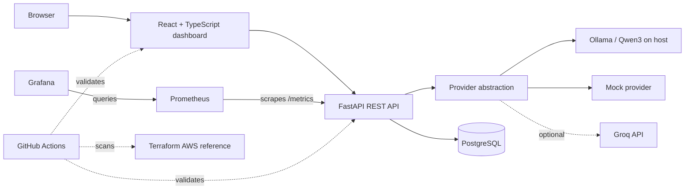
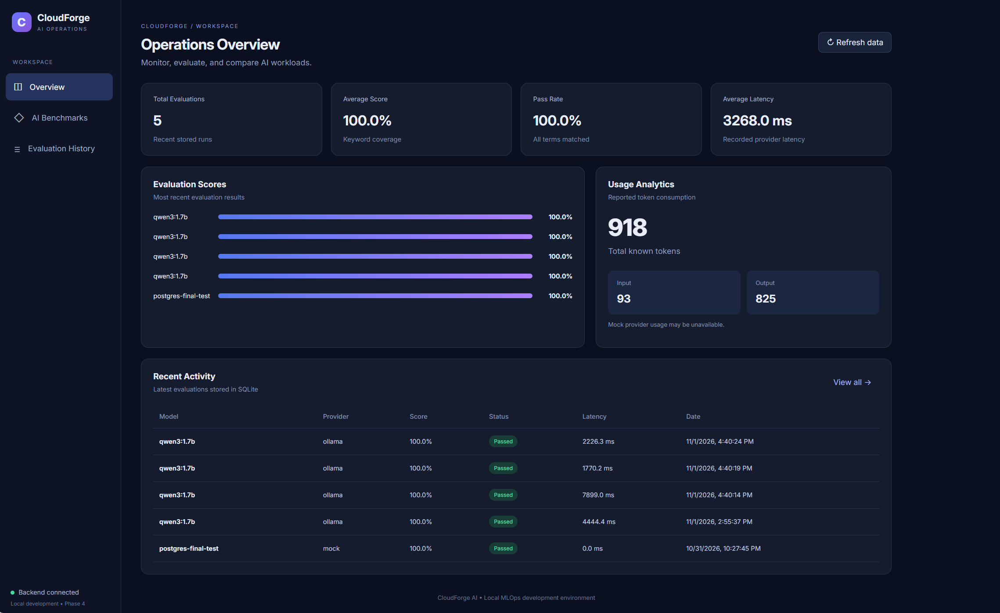
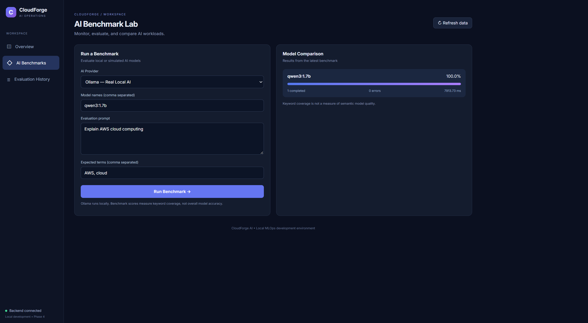
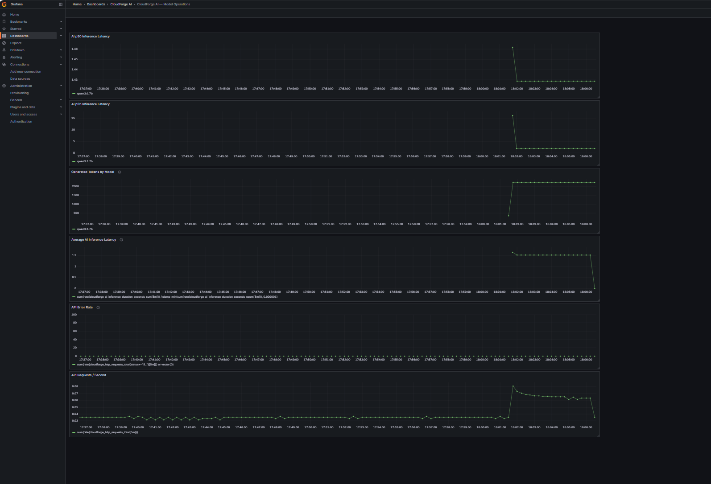
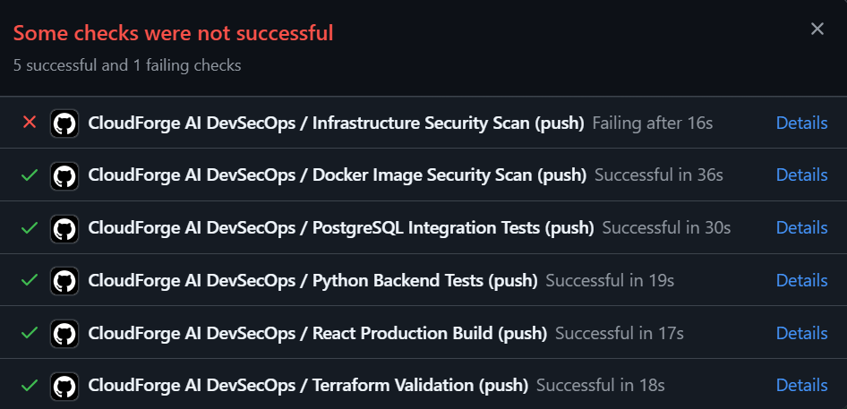

# CloudForge AI

**Local-first AI inference, evaluation, and observability platform** built with FastAPI, React, TypeScript, Ollama, PostgreSQL, Docker Compose, Prometheus, and Grafana.

CloudForge AI is a hands-on AI platform engineering project: run local language models, evaluate responses with transparent keyword checks, compare benchmark cases, persist results, and monitor activity across the API and inference pipeline.

> **Deployment status:** The complete application stack runs locally using Docker Compose; Ollama runs on the host. Terraform describes a possible AWS ECS/Fargate architecture but **has not been deployed or tested on AWS**. Local metrics are not claims of production-scale performance.

## Architecture



Docker Compose starts the dashboard, API, PostgreSQL, Prometheus, and Grafana. The containerized API reaches host Ollama through `host.docker.internal`.

## Features

- **Local LLM inference:** Ollama provider with Qwen3, alongside mock and optional Groq providers.
- **AI Benchmark Lab:** Run bounded evaluation cases and compare model outputs, response times, and reported token usage.
- **Transparent evaluation:** Expected-term coverage scoring; **not** a semantic accuracy or model-quality assessment.
- **Persistent history:** Save and query runs in PostgreSQL, with a SQLite fallback when `DATABASE_URL` is unset.
- **Readiness and recovery:** `/health` tests process liveness; `/ready` verifies database connectivity. Validated a 503 response during database interruption and recovery to 200 after restart.
- **Observability:** Prometheus metrics for HTTP requests, AI runs, inference duration, and token counts; Grafana dashboard provisioned from repository files.
- **Repeatable benchmarks:** Sequential Python workload runner with JSON and CSV exports, end-to-end latency percentiles, Ollama native generation speed, and finish-reason reporting.
- **DevSecOps:** GitHub Actions for Python tests, React lint/build, real PostgreSQL integration testing, Terraform validation, and Trivy security scans.

## Technology stack

| Layer                    | Technologies                                                                  |
| ------------------------ | ----------------------------------------------------------------------------- |
| Frontend                 | React, TypeScript, Vite, CSS                                                  |
| API and testing          | Python, FastAPI, Pydantic, Pytest                                             |
| Models                   | Ollama (local Qwen3), mock provider; optional Groq                            |
| Storage                  | PostgreSQL 17; SQLite development fallback                                    |
| Monitoring               | Prometheus 3, Grafana 12                                                      |
| Containers               | Docker Compose                                                                |
| Infrastructure reference | Terraform, AWS ECS Fargate, ECR, ALB, VPC, IAM, CloudWatch (**not deployed**) |
| CI/security              | GitHub Actions, Trivy                                                         |

## Project Screenshots

### Operations Dashboard



_The main operations dashboard provides a centralized interface for viewing AI evaluations, performance metrics, and historical model activity._

### AI Benchmark Lab



_The benchmarking interface allows users to test AI models, compare evaluation scores, measure inference latency, and analyze token usage._

### Grafana Monitoring



_Real-time observability powered by Prometheus and Grafana, tracking API traffic, inference latency, model execution, and generated tokens._

### GitHub Actions CI/CD



_An automated DevSecOps pipeline that runs backend tests, PostgreSQL integration tests, frontend builds, Terraform validation, and security scans._

> **Note:** The CI/CD pipeline currently has one failing security check related to the AWS Terraform infrastructure. Trivy flagged a publicly accessible load balancer and unrestricted outbound traffic. The AWS infrastructure is included as a reference architecture and has not been deployed. All other pipeline checks, including backend tests, PostgreSQL integration tests, frontend builds, Terraform validation, and Docker image security scanning, passed.

## Quick start — Docker Compose (recommended)

**Prerequisites:** Docker Desktop, Git, and [Ollama](https://ollama.com/) installed on the host. Download the local model once:

```powershell
ollama pull qwen3:1.7b
ollama list
```

Clone and start the stack:

```powershell
git clone https://github.com/jonathanprogram2/CloudForge-AI.git
cd CloudForge-AI
docker compose up -d --build
```

Open these local endpoints:

| Service               | URL                          |
| --------------------- | ---------------------------- |
| React dashboard       | http://127.0.0.1:5173        |
| FastAPI documentation | http://127.0.0.1:8000/docs   |
| API liveness          | http://127.0.0.1:8000/health |
| Database readiness    | http://127.0.0.1:8000/ready  |
| Prometheus            | http://127.0.0.1:9090        |
| Grafana               | http://127.0.0.1:3000        |

**Grafana local-only development credentials:** `admin` / `cloudforge_local_only` (defined in `compose.yaml`; change these before exposing the service). The application and monitoring ports bind to localhost. Ollama must be running on the host for real local inference; mock mode does not require it. Use **`docker compose down`** to stop the stack without deleting persistent volumes; **do not use `down -v`** if you want to retain saved runs and Grafana data.

### Local Python tests

Windows PowerShell, from the repo root:

```powershell
py -3.12 -m venv .venv
.\.venv\Scripts\Activate.ps1
python -m pip install -r requirements.txt
python -m pytest -q
```

The most recently verified local result was **27 tests passed, 1 PostgreSQL integration test skipped** (because the local shell did not define `DATABASE_URL`). GitHub Actions runs the PostgreSQL integration test against a temporary PostgreSQL service. To test the frontend outside Docker:

```powershell
cd frontend
npm ci
npm run lint
npm run build
```

### API example

```powershell
$body = @{ provider = 'ollama'; model_name = 'qwen3:1.7b'; prompt = 'Explain Docker Compose briefly'; expected_terms = @('Docker') } | ConvertTo-Json
Invoke-RestMethod -Method Post -Uri 'http://127.0.0.1:8000/api/v1/runs' -ContentType 'application/json' -Body $body
```

The mock provider can be used instead of `ollama` without a model download.

### Key endpoints

| Method | Endpoint              | Purpose                                       |
| ------ | --------------------- | --------------------------------------------- |
| GET    | `/health`             | Process liveness                              |
| GET    | `/ready`              | Database readiness                            |
| GET    | `/metrics`            | Prometheus metrics                            |
| GET    | `/api/v1/info`        | Service metadata                              |
| POST   | `/api/v1/evaluations` | Evaluate supplied text against expected terms |
| POST   | `/api/v1/runs`        | Generate, score, persist and instrument a run |
| GET    | `/api/v1/runs`        | Recent evaluation history                     |
| POST   | `/api/v1/benchmarks`  | Bounded model/case comparisons                |
| GET    | `/api/v1/metrics`     | Saved-run summary                             |

## Measured local performance

An initial Qwen3 1.7B test on an **NVIDIA RTX 4070 Laptop GPU (8 GB VRAM), Intel i7-13700HX, 16 GB RAM** used one warm-up and ten sequential measured requests:

| Follow-up benchmark metric                    |                   Result |
| --------------------------------------------- | -----------------------: |
| Successful requests                           |                    10/10 |
| Mean end-to-end request latency               |              1,387.38 ms |
| p50 request latency                           |              1,629.63 ms |
| p95 request latency                           |              1,658.62 ms |
| Native Ollama generation throughput           | 163.04 output tokens/sec |
| Replies stopped at configured 256-token limit |                     8/10 |

These results show **local performance on a small, single-concurrency workload**; they do not establish production p95 latency, output quality, or answer completeness. The throughput calculation uses the sum of Ollama-reported output tokens divided by the sum of native model generation durations; it is not HTTP throughput.

See [benchmark methods and limitations](docs/PERFORMANCE.md), [initial report](docs/performance/benchmark_report.json), and [follow-up report](docs/performance/benchmark_report_v2.json).

Reproduce the benchmark from your local Python environment while the stack and Ollama are running:

```powershell
python scripts/benchmark_performance.py --model qwen3:1.7b --runs 10 --output reports/performance
```

Generated `reports/` output is ignored by Git; published results under `docs/performance/` are reviewed snapshots.

## Repository guide

```text
app/                           FastAPI, AI providers, history, observability
frontend/                      React + TypeScript dashboard
monitoring/prometheus/         Scrape configuration
monitoring/grafana/            Provisioned datasource and dashboard
scripts/benchmark_performance.py  Local benchmark runner
reports/                       Generated, ignored benchmark reports
docs/PERFORMANCE.md            Benchmark methodology, limitations, measurements
docs/performance/              Reviewed benchmark data snapshots
tests/                         Unit, API, reliability, integration tests
.github/workflows/ci.yml       CI pipeline
infrastructure/terraform/      Unprovisioned AWS reference architecture
compose.yaml                   Local stack
Dockerfile                     Backend image
```

## Security and deployment limitations

- **AWS is not deployed.** Terraform provides an infrastructure design reference, not a production environment.
- An existing Trivy infrastructure scan reported a **public ALB** and **unrestricted ECS outbound egress**. The ALB's public exposure may be intentional for a future HTTPS API, but the network design needs review and remediation before any cloud deployment. Do not assume that all GitHub Actions checks pass.
- Grafana uses local development credentials; the current application is intended for trusted local use, not public hosting.
- No user authentication, public production deployment, or production load testing is claimed.
- The expected-term score only measures keyword coverage. Reaching a token limit can truncate valid model answers.
- Never commit secrets, credentials, `.env` files, Terraform state, or database volumes.

## Roadmap

- Harden Terraform networking and resolve security findings before any AWS deployment.
- Expand benchmarking with larger sample sizes, native token generation metrics, and controlled model comparisons.
- Add authentication and production secret handling before exposing the API publicly.
- Build deployment and recovery playbooks for a real production environment.

## Project scope

Built as an independently developed engineering portfolio project to demonstrate full-stack AI systems, local inference, storage, observability, performance measurement, and CI security practices.
