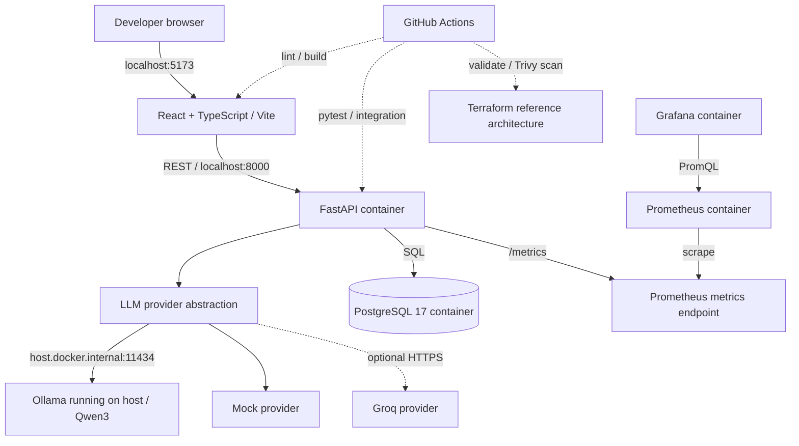

# CloudForge AI — System Architecture

## Running local system

## Request flow

1. The developer triggers a model run or comparison from the dashboard.
2. React sends an HTTP request to FastAPI.
3. FastAPI selects the mock, Ollama, or optional Groq provider.
4. The provider returns generated text, latency, and reported token usage. Ollama can also return native inference duration and completion reason.
5. FastAPI evaluates expected-term coverage (not semantic accuracy) and persists the run to PostgreSQL.
6. The API increments Prometheus counters and histograms; Prometheus scrapes the metrics endpoint and Grafana displays the time series.

## Reliability boundaries

- `/health` checks API process liveness; `/ready` checks database connectivity.
- PostgreSQL data persists in a named Docker volume. Stop with `docker compose down`, not `down -v`.
- The application is local-first. Ollama is not deployed with Compose and must be reachable on the host.
- The Terraform AWS architecture is **unprovisioned** and has unresolved infrastructure security findings; it should not be represented as a live production topology.

## Measurement boundaries

- **API request latency:** measured by the benchmark runner around a complete HTTP request.
- **Model request latency:** duration measured inside the provider's call to Ollama.
- **Native decoding throughput:** Ollama's `eval_count` divided by `eval_duration` in seconds, aggregated over measured calls.
- **p50/p95:** computed from the small observed request-latency sample; do not extrapolate to production tail latency.
